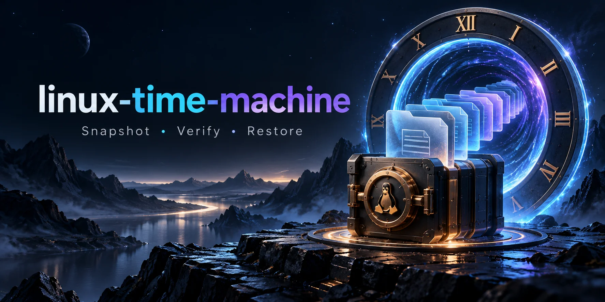

# Linux Time Machine



A local web dashboard for snapshot history, file browsing, content comparisons, SHA-256 verification, and recovery into separate folders. Python standard library + SQLite + HTML/CSS/JavaScript, with an optional Docker Compose setup.

Built as a new learning and portfolio project for Jason Edwards. It reuses the archive engine from the Backup & Restore Toolkit and adds a browser interface, history database, selected-file recovery, and local request protections. It has not been deployed on Jason's home server or used by an employer.

## Run locally

Requires Linux and Python 3.11 or newer. No pip or npm installation is needed.

```bash
python3 server.py
```

Open **http://127.0.0.1:8780**. Click **Load demo history** to create two snapshots of fictional files. Compare the versions, select a file, and restore it. The demo includes a changed configuration, an added release note, and a removed file.

By default, all app data is under `data/` relative to the directory where you run the command:

| Location | Purpose |
| --- | --- |
| `data/source/` | Default source folder; demo files are created here |
| `data/backups/` | Verified `.tar.gz` snapshots with manifests |
| `data/recovery/restore-.../` | Newly recovered files |
| `data/history.sqlite3` | Snapshot metadata and successful recovery journal |

The terminal prints the full recovery location. Re-run `python3 server.py` from the same directory to retain that workspace. Stop with Ctrl+C. The demo button is available only when the default source is empty and no snapshots exist; it never initializes a configured custom source.

## Use your own small test folder

Start with copies of expendable files, not your entire home directory:

```bash
python3 server.py --data "$HOME/.local/share/linux-time-machine" \
  --source "$HOME/Documents/backup-demo"
```

The source must already exist. Source/data paths are fixed at startup, not supplied by the browser. App data must be outside the source tree, and source files cannot be inside backup/recovery storage. A custom source is read for backups; the app does not modify it. Stop active writers first: these backups are not atomic filesystem snapshots or database-native backups.

## Features and integrity rules

- **Create snapshot:** stream regular files into a compressed archive, record SHA-256 checksums, verify the archive, and commit history only after success.
- **Browse:** list snapshot files and sizes with checksum prefixes; filter and select them for recovery.
- **Compare:** compare two recorded manifests and count added, missing, changed, and unchanged regular files. It does not scan the current source or compare permissions.
- **Verify:** read the archive and validate every member/checksum against its manifest and the saved database manifest. A failed check marks the snapshot as failed.
- **Restore selected:** verify the whole archive, copy selected files into a fresh staging folder, verify their hashes again, then expose a new recovery folder and journal record.

**Restore never overwrites your source.** Every successful restore creates a separate folder. The app does not offer automatic replacement, deletion, retention policies, scheduled backups, or cloud upload. Unreadable/changing files can fail a snapshot. Symlinks are skipped with a terminal warning; special files are unsupported. Source and storage trees must be controlled by your user: this is not hardened against another local user concurrently manipulating filesystem paths.

Restored regular files use permissions `0600`; directories use `0700`. Original ownership, timestamps, executable bits, ACLs, extended attributes, devices, symlinks, and hardlink relationships are not preserved. Full empty-directory recovery is not offered by the selected-file UI. These are document/configuration snapshots, not bootable system images.

Archive validation rejects unsafe paths, unsupported entries, duplicate members, unlisted entries, and checksum mismatches. Limits inherited from the archive toolkit are 10 GiB of uncompressed members (including manifest), 100,000 entries, and a 16 MiB manifest. The UI lists the first 1,000 alphabetically sorted file paths, supports up to 1,000 selected paths per restore, and displays up to 1,000 changed paths per comparison. Counts cover the full manifests; browsing/filtering covers only the displayed subset. The recovery journal displays the latest 30 successful operations while its total count covers all records.

## Local request protection and privacy

The default server binds to loopback and has no user login or TLS. Mutations require a per-start session token, expected local Host, JSON content type, and matching browser Origin when present. These checks reduce cross-site request risks; **they do not authenticate local processes or replace real access control**. No arbitrary files, backups, database files, or restored content are served by HTTP.

Keep the app local. For remote viewing, use an SSH tunnel:

```bash
ssh -L 8780:127.0.0.1:8780 YOUR_USER@YOUR_SERVER
```

Open http://127.0.0.1:8780 on the client. `--host` exists for Docker use, not for public exposure. Only `localhost` and `127.0.0.1` with the configured port are accepted as Host headers. Reverse proxies/port remapping require separate review/configuration; there is no public hosting or multi-user mode.

Archives and history reveal filenames and file content. They are not encrypted or signed. Checksums detect content corruption, not malicious changes by someone who can modify both archives and database. Keep real data under the ignored data directory, maintain a separate/offsite backup for real disaster recovery, and review files before any GitHub publication.

Operations are synchronous and serialized within one server process. Large backups or restores may take time; the UI shows a busy message without percentage progress. Closing the browser does not guarantee cancellation. Do not run multiple server instances against the same data/source directories. History migrations, orphan-archive reconciliation after a crash, and filesystem crash-durability guarantees are outside this version.

## Docker

```bash
docker compose config --quiet
docker compose up --build -d --wait
```

Open http://127.0.0.1:8780 and load the demo. The container runs unprivileged with a read-only root filesystem; the named volume stores the default source, archives, history, and recovery folders. `docker compose down` preserves the volume. `down -v` deletes the entire app workspace. The base image is a floating tag, not a digest-pinned production build. Custom host-folder access requires a deliberately configured source bind mount; the supplied Compose file does not mount your Documents directory.

## Tests and verification

```bash
python3 -m unittest discover -s tests -v
node --check web/app.js
bash -n publish.sh
```

Thirteen automated tests use temporary directories, real archives, SQLite, and local HTTP requests. They cover persistent history, archive verification, additions/changes/removals, exact restored bytes, unchanged source content, unique recovery folders, unsafe/missing/duplicate selections, corrupt/unlisted archive entries, guarded demo initialization, storage placement, session/Origin/Host protections, and rejection of arbitrary HTTP file access. The complete HTTP lifecycle smoke test is also exercised against a disposable workspace, with its recovered bytes and unchanged source checked on disk.

Node is optional for JavaScript syntax checks; it is not an app runtime dependency. Docker is unavailable and browser preview is unavailable under the current managed environment's browser-tool rules, so full container startup and visual browser layout have **not** been verified here. The GitHub Actions workflow includes Python tests, JavaScript/shell checks, and a Docker lifecycle smoke test; a workflow file is not proof that CI has run successfully.

## Publish

With GitHub CLI already authenticated:

```bash
bash publish.sh
```

This creates public repository `cuzzaintit321/linux-time-machine`, sets the description, and pushes source/docs/tests/example workflow. It stops if a local checkout or repository already exists. Inspect partial publication before retrying. No software license has been selected on your behalf.
